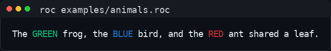
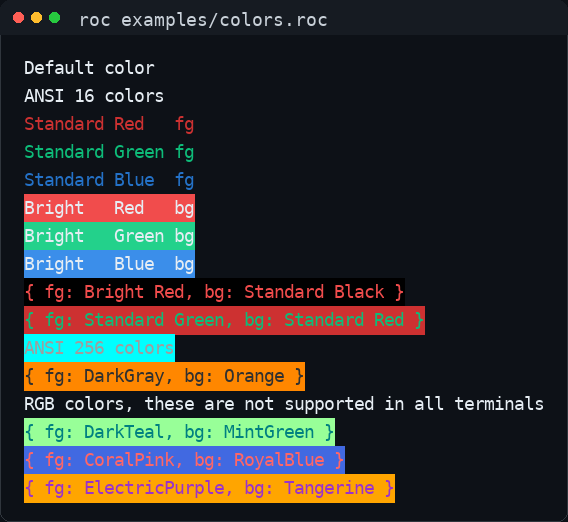
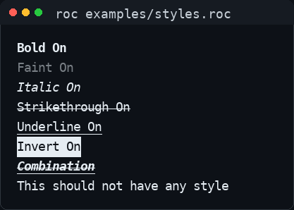
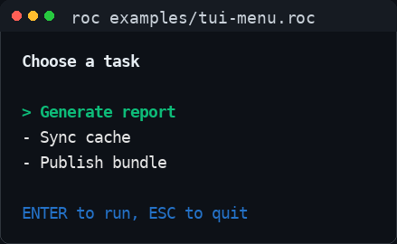
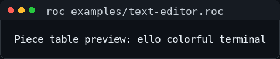

# Roc ANSI

Helpers for working with ANSI terminal control sequences in Roc.

## Example - Animals

Run with `roc examples/animals.roc`



## Example - Colors

Run with `roc examples/colors.roc`



## Example - Styles

Run with `roc examples/styles.roc`



## Example - Menu

Run with `roc examples/menu.roc`



## Example - Piece Table

Run with `roc examples/piece-table.roc`



## Development

The examples in this repository depend on the package by relative path
(`ansi: "../package/main.roc"`), so `roc examples/animals.roc` runs an example
against your working tree. Nothing pins a Roc compiler for the package or the
examples: use the [latest nightly](https://github.com/roc-lang/nightlies/releases).

To use the examples outside this repository, download the
`roc-ansi-examples-VERSION.zip` archive attached to a
[release](https://github.com/lukewilliamboswell/roc-ansi/releases). Its copies
depend on that release's package URL instead.

### Two compilers

| Command | Chosen by | Used for |
| --- | --- | --- |
| `roc` | You: the latest nightly | Checking, testing, bundling and running the package and its examples |
| `roc-stable` | The release named in [`Blueprint.roc`](Blueprint.roc) | Running the scripts in `scripts/` |

`roc-stable` exists so the repository's tooling keeps working when a nightly
breaks something. It never checks or builds the package.

### Run the checks

The scripts are Roc programs that start with `#!/usr/bin/env roc-stable`. Their
environment is declared in `Blueprint.roc`, pinned by `Blueprint.lock`, and
realised by [roc-blueprint](https://github.com/lukewilliamboswell/roc-blueprint).
You need [Nix](https://nixos.org/download) with flakes, the `blueprint` 0.4.0 CLI
from its [release page](https://github.com/lukewilliamboswell/roc-blueprint/releases/tag/0.4.0),
and a nightly `roc` on your `PATH`.

```sh
blueprint run check      # everything CI checks
blueprint shell          # or enter the environment and run scripts directly
```

`blueprint run check` runs [`scripts/check_all.roc`](scripts/check_all.roc), which:

1. Fails if a `roc:` header pin or `.roc-version` has come back.
2. Tests, checks and formats the scripts with `roc-stable`.
3. Formats, checks and tests the package with `roc`.
4. Checks and builds every example against the working tree, runs it, and
   compares its output with the cases recorded in `tests/spec.json`.
5. Builds each fuzz target under `fuzz/` and replays its committed corpus.
6. Counts the allocations of the cases in `tests/allocations.json` and fails
   if one exceeds its recorded ceiling.
7. Bundles the package and builds the examples archive, then serves the bundle
   from a loopback address and repeats step 4 on the archived examples,
   unchanged, with `--replace-dep` pointing their release URL at it.
8. Builds the documentation site and archive.

| Task | What it does |
| --- | --- |
| `blueprint run check` | Everything CI checks |
| `blueprint run bundle` | Bundle the package into `dist` |
| `blueprint run examples` | Run the examples and compare their output with `tests/spec.json`; `scripts/test_examples.roc -- --update` re-records it |
| `blueprint run test-bundle` | Test the examples archive in `dist`, or `EXAMPLES_ARCHIVE`, against the bundle in `dist`, or `BUNDLE_PATH` |
| `blueprint run test-published` | Test the latest release's examples archive, as published |
| `blueprint run site` | Assemble the documentation site |
| `blueprint run serve` | Assemble the site and preview it locally |

### Workflows

| Workflow | Runs on | What it shows |
| --- | --- | --- |
| [`ci.yml`](.github/workflows/ci.yml) | Pull requests, pushes to `main` | The working tree passes `blueprint run check` on the latest nightly |
| [`release.yml`](.github/workflows/release.yml) | Manual dispatch; pull requests as a dry run | The exact bundle and examples archive proposed for publication work |
| [`nightly.yml`](.github/workflows/nightly.yml) | Daily | The latest release's examples archive works on the latest nightly |
| [`www.yaml`](.github/workflows/www.yaml) | Pushes to `main` | Deploys the documentation site |

A pull request can fail because a new nightly arrived, with no fault in the
change. Compare with the latest `nightly.yml` run and with `main` before
treating a failure as a regression.

`nightly.yml` keeps one tracking issue: opened on the first failure, updated on
later failures, closed on the next pass. A failure there means the latest
release needs a patch release. Published archives are never edited.

### Update the tooling

Nothing updates the tooling automatically. `Blueprint.lock` only changes when
someone runs `blueprint update` and opens a pull request with the result.

To change the tooling compiler, open a pull request that changes the nightly
tag in `Blueprint.roc`, and the basic-cli URL there and in every script header
if the scripts need a newer platform. Run `blueprint update` in the same pull
request, and fix any script the new compiler breaks.

## Releasing

Dispatch the **Release** workflow from `main` with a new `release_version`. It:

1. Runs `blueprint run check`, bundles the package, and tests the examples
   against that exact bundle through a loopback address.
2. Publishes the GitHub release with the bundle. The release notes name the
   `roc` and `roc-stable` versions used, which replaces a header pin as the
   record of what the release was built and tested with.
3. Tests the examples archive against the published bundle URL, then attaches
   it as `roc-ansi-examples-VERSION.zip`, with the API docs as
   `roc-ansi-docs-VERSION.zip`.
4. Deploys the documentation site.

The jobs that hold the write token run no code from this repository. No
follow-up pull request is needed, because the examples on `main` never change
for a release. On a pull request the workflow stops after step 1 and publishes
nothing; its bundle and examples archive are kept as workflow artifacts.

## Documentation

See [https://lukewilliamboswell.github.io/roc-ansi/](https://lukewilliamboswell.github.io/roc-ansi/)

Generated API docs are never committed. Each release attaches its docs as
`roc-ansi-docs-VERSION.zip`; the site is assembled from those archives plus
fresh docs for `main`, so historical version URLs keep working without their
HTML being stored in Git. Hand-maintained site files and the vendored
highlighter live in `www/`.

```sh
blueprint run serve                        # main docs only; no downloads
FETCH_RELEASE_DOCS=1 blueprint run serve   # also restore every release's docs
```

The preview picks a free port, or the one named by `SITE_PORT`, and prints its
URL. `FETCH_RELEASE_DOCS=1` downloads release assets with `gh`, which must be
authenticated. `blueprint run site` assembles the same site without serving it,
into `.roc-ansi-tmp/site` or the directory named by `SITE_OUTPUT`.

The landing page shows a terminal capture for each runnable example, linking to
its source on GitHub. The site vendors the Tree-sitter Roc grammar and web
runtime for client-side highlighting; see
[THIRD_PARTY_LICENSES.md](THIRD_PARTY_LICENSES.md) for license details.
